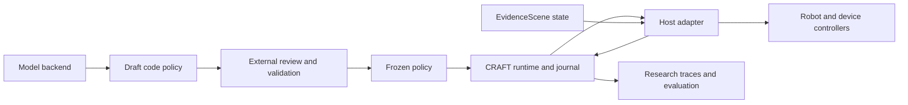

# CRAFT

**Code-based Robotic Automation for Fast-Food Tasks**

[](https://github.com/tiwater/craft/actions/workflows/ci.yml)
[](LICENSE)

CRAFT studies reusable, verifiable and recoverable code policies for beverage and
light-food preparation: coffee service, bagel heating and combined orders.

**Status: v0.1.0 research baseline.** This release contains working software
contracts and deterministic fault-injection fixtures. It does **not** claim
validated physical coffee/bagel manipulation, a completed benchmark, or a paper.
It has not replaced the live ticos-edge CaP runtime.

## Quick start

Python 3.10+; no runtime dependencies, robot, GPU or model credentials required:

```bash
git clone https://github.com/tiwater/craft.git
cd craft
python -m venv .venv
source .venv/bin/activate
pip install -e '.[dev]'
craft demo --task combo --lost-receipt
pytest
```

The demo runs a **software contract fixture**, loses a heating acknowledgement,
reopens the command journal, queries the same command and finishes the order.
Each fixture action is dispatched once. No robot or simulator is connected.
The fixture uses hand-authored code, not an LLM-generated policy; it models no
heat transfer, collision, grasp, timing, food quality or hardware behavior.

## Implemented

- Frozen policy bundles with source/deployment/capability content hashes.
- An explicitly limited Python AST interpreter: no `exec`, `eval`, imports,
  loops, arbitrary Python calls or access to host objects.
- SQLite intent-before-dispatch journal. A pending or uncertain command is
  queried on resume; it is never blindly dispatched again.
- Task completion requires adapter verification of the **host-specified goal**.
- Explicit Codex CLI / OpenAI Responses API generation transports, with no
  automatic provider fallback; generated output is a syntax-checked draft.
- Coffee, bagel and combined-order fixtures, including lost-receipt recovery.
- A versioned [literature catalog and BibTeX](references/README.md).

## Policy example

```python
def run_policy(sdk, params):
    observation = sdk.observe()
    if not observation["control_ready"]:
        return {"status": "blocked"}
    sdk.perform("load_bagel", {"order_id": params["order_id"]}, "load")
    sdk.perform("heat", {"order_id": params["order_id"]}, "heat")
    sdk.perform("unload_bagel", {"order_id": params["order_id"]}, "unload")
    sdk.perform("deliver_bagel", {"order_id": params["order_id"]}, "deliver")
    if sdk.verify({"task": "bagel"}):
        return {"status": "completed"}
    return {"status": "blocked"}
```

This example describes a fixture capability contract. Real adapters must define
and enforce door, tool, temperature, occupancy and robot motion conditions.
A hash freezes content; it is **not** approval, a signature or proof of safety.

## Architecture



EvidenceScene remains the perception/reconstruction authority. CRAFT consumes
observations and receipts and must never create a second scene estimator.
The host (for example ticos-edge) owns device adapters, calibration, timeouts,
physical interlocks and success verification. The research UI displays outputs;
it must not fix or invent evidence.

## Optional model generation

```bash
export CRAFT_MODEL='<model available to your backend>'
export CRAFT_REASONING_EFFORT=medium
```

Call `craft.generation.generate(instruction, context, provider="codex_cli")` or
`provider="openai_api"`. API generation requires `OPENAI_API_KEY`; Codex uses its
existing CLI-owned login and a CLI supporting the isolation flags documented in
[deployment](docs/deployment.md). There is no hard-coded model availability claim
or paid fallback. Provider generation does not run a policy or actuate hardware.

## Research scope

Current priority: determine whether CRAFT needs an independent framework.
Adopting an existing project is a valid outcome. See the
[reuse-first gate](docs/decisions/0001-reuse-before-research.md).

The proposed question is whether explicit skill applicability and execution
evidence improve reuse and recovery under held-out disturbances and ambiguous
physical outcomes. This is a hypothesis, not a novelty or superiority claim.
See [research plan](docs/research-plan.md), [architecture](docs/architecture.md),
[provenance](docs/provenance.md) and [limitations](docs/limitations.md).

## Development and citation

Use issues and pull requests. See [CONTRIBUTING](CONTRIBUTING.md).
Cite this software using [CITATION.cff](CITATION.cff). There is no CRAFT paper yet.
Related-work citations are in [references/references.bib](references/references.bib).

Licensed under Apache-2.0. Copyright 2026 Tiwater.
