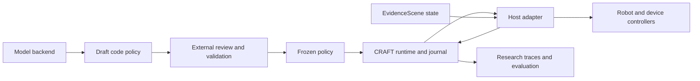

# CRAFT

**Code-based Robotic Automation for Fast-Food Tasks**

[](https://github.com/tiwater/craft/actions/workflows/ci.yml)
[](LICENSE)

CRAFT studies reusable, verifiable and recoverable code policies for beverage and
light-food preparation: coffee service, bagel heating and combined orders.

**Status: v0.3 research platform (Phase 4 — zero-leakage SimEX-parity & multi-appliance operations).**
CRAFT provides a pure-Python-stdlib core orchestration engine, host-independent drivers (`fixture`, `http`, `recorded`, optional `mujoco_cafe` & `gazebo_cafe`), closed-loop simulator calibration + multi-hypothesis repair screening, public-SDK active physical probing, AST-verified executable skill toolboxes, and reproducible benchmarks. It does **not** claim validated physical coffee/bagel manipulation or hardware safety certification. It has not replaced the live `ticos-edge` CaP runtime.

## Product direction and reuse boundary (2026-11-20)

CRAFT is the unified product entry point for scene configuration, teaching
interaction, policy development, independent acceptance verification,
fixed-version release management, and iterative improvement. CRAFT implements
its core business orchestration directly in `src/craft/`, delegates perception
and actuation to existing `ticos-edge` / EvidenceScene authorities, selectively
reuses proven patterns from NVlabs/ASPIRE (Apache-2.0) without making the full
ASPIRE stack a mandatory dependency, and uses ACE-CaP strictly as a teaching
methodology reference.

Phase 1 targets an end-to-end single-cup coffee closed loop in simulation;
bagel/oven automation remains blocked on host appliance capability contracts.
See [product architecture and reuse boundary](docs/decisions/0003-product-architecture-and-reuse-boundary.md)
and the earlier research-necessity record in
[0002-current-reuse-recommendation.md](docs/decisions/0002-current-reuse-recommendation.md).

## Quick start

Python 3.10+; no runtime dependencies, robot, GPU or model credentials required:

```bash
git clone https://github.com/tiwater/craft.git
cd craft
python -m venv .venv
source .venv/bin/activate
pip install -e '.[dev]'
craft demo --task combo --lost-receipt
pytest
```

The demo runs a **software contract fixture**, loses a heating acknowledgement,
reopens the command journal, queries the same command and finishes the order.
Each fixture action is dispatched once. No robot or simulator is connected.
The fixture uses hand-authored code, not an LLM-generated policy; it models no
heat transfer, collision, grasp, timing, food quality or hardware behavior.

## Implemented

- **Core Governance (pure Python stdlib):**
  - Frozen policy bundles (`PolicyBundle` / `ReleaseRegistry`) with source/config/SDK-contract/criteria SHA-256 hashes and version rollback.
  - Restricted Python AST sandbox checker & interpreter: no `exec`, `eval`, imports, arbitrary Python calls, or leading-underscore access.
  - SQLite intent-before-dispatch `Journal` with query-first reconciliation for non-idempotent actions (`start_coffee_machine`, `start_oven_heat`).
  - Independent acceptance gating (`evaluate_acceptance`) strictly separated from policy generation.
  - Four-layer failure attribution (`perception` / `control` / `device` / `policy`) preventing policy hacks from papering over host defects.
- **Closed-Loop Evolution & SimEX-Parity Mechanisms:**
  - **Active Physical Probing** (`src/craft/probing.py`): task-agnostic, budget-capped diagnostic probes strictly over public host SDKs (zero task-specific prompt hints).
  - **Closed-Loop Simulator Calibration + Multi-Hypothesis Screening** (`src/craft/repair_screener.py`): bounded sandbox parameter alignment when initial replay yields `not_reproduced_in_sim`, followed by multi-hypothesis candidate screening against accumulated `RegressionSuite` capability banks.
  - **Verified Executable Skill Toolbox** (`src/craft/skills.py`): AST-validated reusable helper snippets paired with `measured_limits`, `known_failure_modes`, `regression_case_ids`, and automatic invalidation on host SDK contract drift.
  - **Commercial Operations Loop** (`src/craft/operations.py`): Day-Shift continuous execution → Nightly Evolution (`RepairScreener` → zero-actuation `recorded_data` shadow check → independent acceptance → release → verified skill).
- **Host-Independent Drivers & Reproducible Benchmarks:**
  - Built-in `fixture`, `http`, `recorded` drivers plus optional native MuJoCo (`mujoco_cafe` with 7-DOF Panda PBR, optional `--sensor-noise` & `--domain-randomization`), standalone HTTP sim host (`craft serve-sim-host`), and portable Gazebo Fortress exporter (`craft gazebo-export`).
  - Benchmarks: `cafebench-v2`, `sim2sim-bench` (5-trial physics-mismatched Sim-to-Sim adaptation), `robosuite-bench` (zero-leakage 6-method parity including adapted `SimEX-Protocol`), and `combo-bench` (Coffee + Bagel/Oven shared-arm concurrent operations).
  - Versioned [literature catalog and BibTeX](references/README.md) with honest reading-depth provenance.

## Policy example

```python
def run_policy(sdk, params):
    observation = sdk.observe()
    if not observation["control_ready"]:
        return {"status": "blocked"}
    sdk.perform("load_bagel", {"order_id": params["order_id"]}, "load")
    sdk.perform("heat", {"order_id": params["order_id"]}, "heat")
    sdk.perform("unload_bagel", {"order_id": params["order_id"]}, "unload")
    sdk.perform("deliver_bagel", {"order_id": params["order_id"]}, "deliver")
    if sdk.verify({"task": "bagel"}):
        return {"status": "completed"}
    return {"status": "blocked"}
```

This example describes a fixture capability contract. Real adapters must define
and enforce door, tool, temperature, occupancy and robot motion conditions.
A hash freezes content; it is **not** approval, a signature or proof of safety.

## Architecture



EvidenceScene remains the perception/reconstruction authority. CRAFT consumes
observations and receipts and must never create a second scene estimator.
The host (for example ticos-edge) owns device adapters, calibration, timeouts,
physical interlocks and success verification. The research UI displays outputs;
it must not fix or invent evidence.

## Optional model generation

```bash
export CRAFT_MODEL='<model available to your backend>'
export CRAFT_REASONING_EFFORT=medium
```

Call `craft.generation.generate(instruction, context, provider="codex_cli")` or
`provider="openai_api"`. API generation requires `OPENAI_API_KEY`; Codex uses its
existing CLI-owned login and a CLI supporting the isolation flags documented in
[deployment](docs/deployment.md). There is no hard-coded model availability claim
or paid fallback. Provider generation does not run a policy or actuate hardware.

## Research scope

Current priority: determine whether CRAFT needs an independent framework.
Adopting an existing project is a valid outcome. See the
[reuse-first gate](docs/decisions/0001-reuse-before-research.md).

The proposed question is whether explicit skill applicability and execution
evidence improve reuse and recovery under held-out disturbances and ambiguous
physical outcomes. This is a hypothesis, not a novelty or superiority claim.
See [research plan](docs/research-plan.md), [architecture](docs/architecture.md),
[provenance](docs/provenance.md) and [limitations](docs/limitations.md).

## Development and citation

Use issues and pull requests. See [CONTRIBUTING](CONTRIBUTING.md).
Cite this software using [CITATION.cff](CITATION.cff). There is no CRAFT paper yet.
Related-work citations are in [references/references.bib](references/references.bib).

Licensed under Apache-2.0. Copyright 2026 Tiwater.
