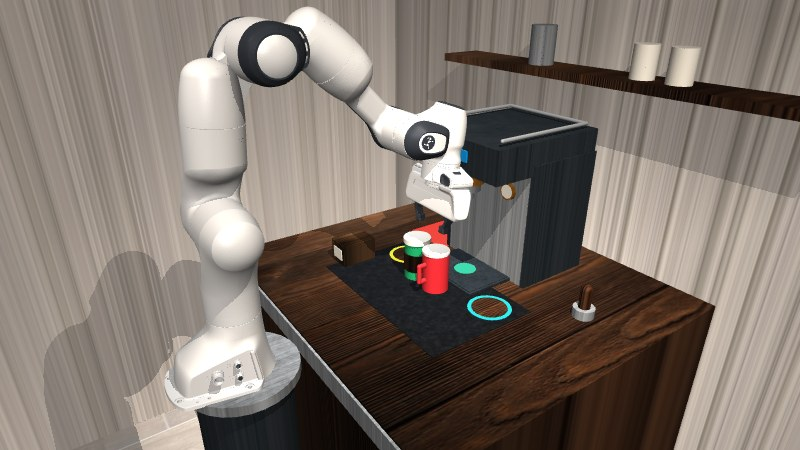
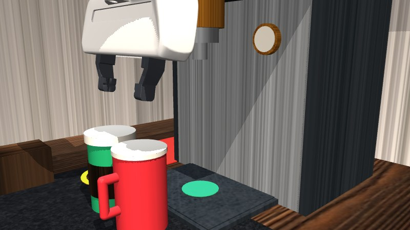
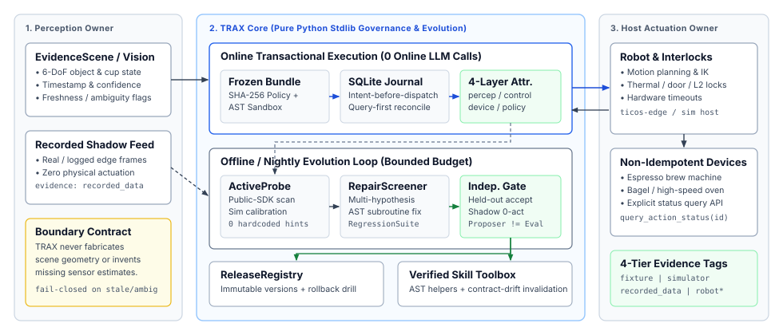
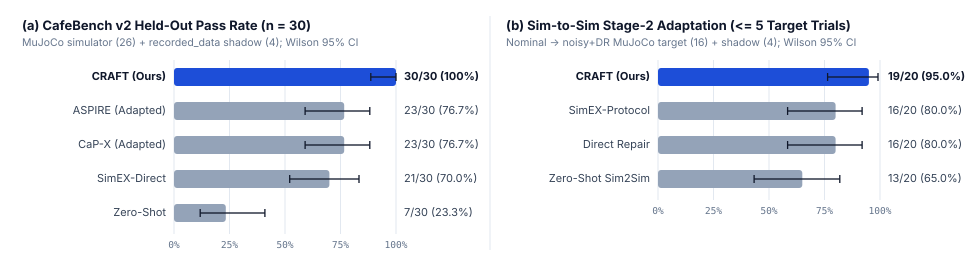
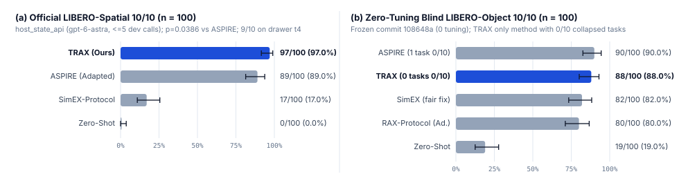

<div align="center">

# TRAX: Transactional, Crash-Recoverable, and Ownership-Separated Code Policies for Real-World Robotics

**Tiwater**<br>
[research@tiwater.com](mailto:research@tiwater.com)

[](https://github.com/tiwater/trax/actions/workflows/ci.yml)
[](LICENSE)

[**Project Page**](https://tiwater.github.io/trax/) • [**Paper Draft (PDF)**](docs/assets/papers/trax.pdf) • [**Benchmarks**](#-quantitative-results) • [**Quick Start**](#-quick-start) • [**License (Apache 2.0)**](LICENSE)

</div>

---

<div align="center">
  <table>
    <tr>
      <td align="center" width="33%">
        
        <br/><sub><b>(a) 7-DOF Panda Café Cell</b><br/>MuJoCo 3.3.0 PBR workstation (<code>simulator</code>).</sub>
      </td>
      <td align="center" width="33%">
        
        <br/><sub><b>(b) Overhead Layout</b><br/>Cup slip, layout shift &amp; DR target.</sub>
      </td>
      <td align="center" width="33%">
        
        <br/><sub><b>(c) Spout Alignment</b><br/>Host interlocks &amp; independent acceptance.</sub>
      </td>
    </tr>
  </table>
</div>

> **Evidence boundary notice:** TRAX keeps `fixture`, `simulator`, `recorded_data`, and `physical_robot` evidence strictly separate (see [`AGENTS.md`](AGENTS.md)). All empirical benchmarks reported below are **`simulator`** (MuJoCo 3.3.0 / Robosuite 1.5.2 / optional LIBERO) and **`recorded_data`** (zero-actuation recorded-frame shadow replay). TRAX does **not** claim validated physical manipulation or hardware safety certification; it has not replaced the live `ticos-edge` CaP runtime. *(Note: TRAX was formerly developed under codename `CRAFT`; archived JSON receipts under `experiments/` retain legacy internal method keys without altering any numerical results.)*

## Overview

**TRAX** (*Transactional Robot Action Execution*) is a pure-Python-stdlib policy governance, crash reconciliation, and bounded offline evolution framework designed for real-world commercial robotic workstations (espresso brewing, bagel/oven heating, and shared-arm multi-appliance orders):

1. **Strict Three-Owner Separation (`src/trax/policy.py`, `src/trax/edge_adapter.py`):** Perception ownership (e.g., [EvidenceScene](https://tiwater.github.io/evidencescene/)), TRAX policy execution, and host actuation/interlocks (`ticos-edge` or simulator host) remain decoupled. TRAX never fabricates scene state and enforces four-layer failure attribution (`perception` / `control` / `device` / `policy`).
2. **Deterministic AST Sandbox & SQLite Intent Journal (`src/trax/journal.py`, `src/trax/runtime.py`):** Online service runs SHA-256-frozen policy bundles with **0 online LLM calls**, persisting intent before dispatching non-idempotent appliance commands (`start_coffee_machine`, `start_oven_heat`) and reconciling crashes via host `query_action_status`.
3. **Zero-Leakage Active Probing & Closed-Loop Calibration (`src/trax/probing.py`, `src/trax/repair_screener.py`):** Removes all hardcoded task-specific physics hints (enforced by automated tests) in favor of budget-capped public-SDK diagnostic probing, bounded simulator alignment, multi-hypothesis `RepairScreener`, AST-guided selective subroutine repair, and negative-attempt memory.
4. **Decoupled Governance & Verified Skill Toolbox (`src/trax/acceptance.py`, `src/trax/skills.py`, `src/trax/operations.py`):** Separates policy generation from zero-actuation `recorded_data` shadow gating and independent acceptance, publishes immutable releases with rollback drills, and stores AST-validated executable skill snippets with automatic contract-drift invalidation.

<div align="center">
  
</div>

---

## Quantitative Results

All LLM-driven tracks use a matched real model backend (`gpt-6-astra`, `codex_cli`, `effort=medium`) and archived JSON receipts under [`experiments/`](experiments/).

| Benchmark Track | Evidence Source | Strongest Baseline | **TRAX (Ours)** | Key Operational Metric |
| :--- | :---: | :---: | :---: | :--- |
| **CafeBench v2** *(n=30 held-out)* | `simulator` + `recorded_data` | ASPIRE / CaP-X: `23/30` (76.7%, 6 LLM) | **`30/30` (100.0%, 2 LLM)** | **+23.3 pp** (`p = 0.0156`), **0** dup, **0** false act |
| **Sim-to-Sim Stage-2** *(≤5 target trials, n=20)* | `simulator` + `recorded_data` | SimEX-Protocol: `16/20` (80.0%) | **`19/20` (95.0%)** | `15/16` target + `4/4` shadow (`p = 0.0313` vs Zero-Shot `13/20`) |
| **CafeBench v3 Combo** *(Coffee + Oven, n=12)* | `simulator` | Sequential Stateless: `9/12` (46.7/hr, 3 dup) | **`12/12` (100.0%, 75.9/hr)** | **+62.5% throughput**, **0** dup, **0** interlock violations |
| **Zero-Leakage Robosuite v4** *(4 tasks, n=80)* | `simulator` | CaP-X (online Turn-2): `67/80` (83.8%) · SimEX: `51/80` | **`72/80` (90.0%, #1 on all 4 tasks)** | **0** eval LLM, `2.05 s` p95 (**23×** faster vs CaP-X), `p ≤ 1.9e-5` vs frozen |
| **Official LIBERO-Spatial 10/10** *(n=100, `host_state_api`)* | `simulator` | ASPIRE: `89/100` (89.0%) · SimEX: `17/100` | **`97/100` (97.0%, 2.1 calls/task)** | **`p = 0.0386`** vs ASPIRE; `9/10` on top-drawer `t4` (all baselines `0/10`) |
| **Zero-Tuning Blind LIBERO-Object 10/10** *(n=100, frozen `108648a`)* | `simulator` | ASPIRE: `90/100` (`t1=0/10`) · SimEX: `82/100` · RAX-Protocol (Ad.): `80/100` | **`88/100` (88.0%, 0 collapsed tasks)** | **+8.0 pp** vs matched RAX-Protocol; `t1=9/10`; **257/280 (91.8%)** across all 24 external tasks |

> *Unmatched RGB-D literature reference:* RAX (`huang2026rax`, Table 6: `256×256` RGB-D + 3 goal images, Claude Opus 5.5, ≤20 episodes/task, `n=500`/suite) reports `99.2%` on LIBERO-Spatial and `100.0%` on LIBERO-Object (Robosuite N/R). Because the observation contract and compute budget differ, RAX Table 6 is cited separately from matched-contract `host_state_api` rows.

<div align="center">
  
  <br/><br/>
  
</div>

> Complete archived logs, preserved intermediate runs (including Sim2Sim Run 1 `8/20` and pre-fix Robosuite/LIBERO iterations), frozen policies, and HTML reports: [`experiments/trax-2.0-m1/README.md`](experiments/trax-2.0-m1/README.md), [`experiments/goal-v2-20261122/README.md`](experiments/goal-v2-20261122/README.md), and [`experiments/goal-v3-simex-parity/README.md`](experiments/goal-v3-simex-parity/README.md).

---

## Quick Start

Python 3.10+. Core runtime and tests require **zero** third-party runtime dependencies, robots, GPUs, or LLM credentials:

```bash
git clone https://github.com/tiwater/trax.git
cd trax
python3 -m venv .venv
source .venv/bin/activate
pip install -e '.[dev]'

make test            # Run full unit & regression test suite
make check-stdlib    # Verify pure-Python-stdlib invariant across core src/trax/
make demo            # Run software fixture crash / lost-receipt reconciliation demo
```

### Reproducing Paper Tables, Figures & Preprint PDF

```bash
make artifacts       # Deterministically regenerate LaTeX tables & SVG figures from archived JSON receipts
make paper           # Compile papers/trax/main.tex via Tectonic -> papers/trax/trax.pdf & docs/assets/papers/trax.pdf
make check-site      # Verify all local asset & document links in docs/index.html
```

Optional simulation benchmarks require MuJoCo (`pip install mujoco robosuite pillow`) or an isolated LIBERO virtualenv (`.venv-libero`):

```bash
trax cafebench-v2 --help
trax sim2sim-bench --help
trax combo-bench --help
trax robosuite-bench --help
trax libero-bench --help
```

---

## Repository Structure

```text
trax/
├── src/trax/                  # Pure-Python-stdlib core (policy, journal, runtime, probing,
│                              # repair_screener, skills, acceptance, operations, studio)
│                              # + isolated optional sim drivers (mujoco_cafe_driver, robosuite_bench, libero_bench)
├── papers/trax/               # Single-column technical report (trax.cls), auto-generated tables/ & trax.pdf
├── docs/                      # Academic project page (https://tiwater.github.io/trax/) & architecture docs
├── tools/                     # Deterministic JSON-receipt -> LaTeX table & SVG figure generator
├── experiments/               # Archived benchmark JSON receipts, HTML reports, frozen policies & logs
├── references/                # Versioned literature catalog (catalog.json, references.bib, honest notes)
├── examples/                  # Workstation & combo configuration templates
├── sim/                       # Portable Gazebo Fortress / MuJoCo café scene assets
├── tests/                     # Unit, failure-injection, zero-leakage & integration test suite
└── Makefile                   # Reproducible test, stdlib-check, artifacts, paper & site targets
```

---

## Citation

```bibtex
@article{tiwater2026trax,
  title   = {{TRAX}: Transactional, Crash-Recoverable, and Ownership-Separated Code Policies for Real-World Robotics},
  author  = {{Tiwater}},
  journal = {arXiv preprint},
  year    = {2026},
  url     = {https://tiwater.github.io/trax/}
}
```

See also [`CITATION.cff`](CITATION.cff), [`CONTRIBUTING.md`](CONTRIBUTING.md), and [`references/references.bib`](references/references.bib). Licensed under Apache-2.0. Copyright 2026 Tiwater.
