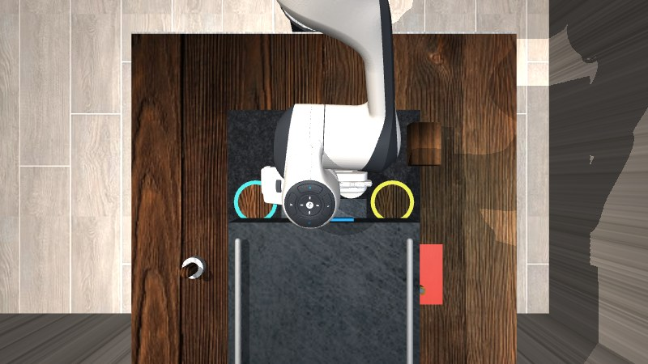
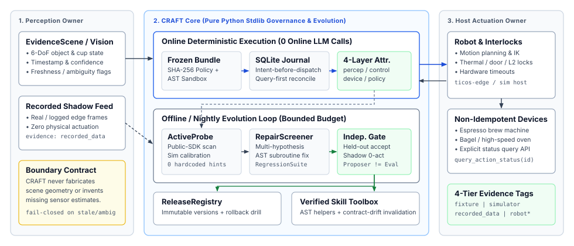

<div align="center">

# CRAFT: Verifiable, Crash-Recoverable, and Ownership-Separated Code Policies for Commercial Fast-Food Robotics

**Tiwater**<br>
[research@tiwater.com](mailto:research@tiwater.com)

[](https://github.com/tiwater/craft/actions/workflows/ci.yml)
[](LICENSE)

[**Project Page**](https://tiwater.github.io/craft/) • [**Paper Draft (PDF)**](docs/assets/papers/craft.pdf) • [**Benchmarks**](#-quantitative-results) • [**Quick Start**](#-quick-start) • [**License (Apache 2.0)**](LICENSE)

</div>

---

<div align="center">
  <table>
    <tr>
      <td align="center" width="33%">
        
        <br/><sub><b>(a) 7-DOF Panda Café Cell</b><br/>MuJoCo 3.3.0 PBR workstation (<code>simulator</code>).</sub>
      </td>
      <td align="center" width="33%">
        
        <br/><sub><b>(b) Overhead Layout</b><br/>Cup slip, layout shift &amp; DR target.</sub>
      </td>
      <td align="center" width="33%">
        
        <br/><sub><b>(c) Spout Alignment</b><br/>Host interlocks &amp; independent acceptance.</sub>
      </td>
    </tr>
  </table>
</div>

> **Evidence boundary notice:** CRAFT keeps `fixture`, `simulator`, `recorded_data`, and `physical_robot` evidence strictly separate (see [`AGENTS.md`](AGENTS.md)). All empirical benchmarks reported below are **`simulator`** (MuJoCo 3.3.0 / Robosuite 1.5.2 / optional LIBERO) and **`recorded_data`** (zero-actuation recorded-frame shadow replay). CRAFT does **not** claim validated physical coffee/bagel manipulation or hardware safety certification; it has not replaced the live `ticos-edge` CaP runtime.

## Overview

**CRAFT** (*Code-based Robotic Automation for Fast-Food Tasks*) is a pure-Python-stdlib policy governance, crash reconciliation, and bounded offline evolution framework designed for commercial food-service robotics (coffee brewing, bagel/oven heating, and shared-arm combo orders):

1. **Strict Three-Owner Separation (`src/craft/policy.py`, `src/craft/edge_adapter.py`):** Perception ownership (e.g., [EvidenceScene](https://tiwater.github.io/evidencescene/)), CRAFT policy execution, and host actuation/interlocks (`ticos-edge` or simulator host) remain decoupled. CRAFT never fabricates scene state and enforces four-layer failure attribution (`perception` / `control` / `device` / `policy`).
2. **Deterministic AST Sandbox & SQLite Intent Journal (`src/craft/journal.py`, `src/craft/runtime.py`):** Online service runs SHA-256-frozen policy bundles with **0 online LLM calls**, persisting intent before dispatching non-idempotent appliance commands (`start_coffee_machine`, `start_oven_heat`) and reconciling crashes via host `query_action_status`.
3. **Zero-Leakage Active Probing & Closed-Loop Calibration (`src/craft/probing.py`, `src/craft/repair_screener.py`):** Removes all hardcoded task-specific physics hints (enforced by automated tests) in favor of budget-capped public-SDK diagnostic probing, bounded simulator alignment, multi-hypothesis `RepairScreener`, AST-guided selective subroutine repair, and negative-attempt memory.
4. **Decoupled Governance & Verified Skill Toolbox (`src/craft/acceptance.py`, `src/craft/skills.py`, `src/craft/operations.py`):** Separates policy generation from zero-actuation `recorded_data` shadow gating and independent acceptance, publishes immutable releases with rollback drills, and stores AST-validated executable skill snippets with automatic contract-drift invalidation.

<div align="center">
  
</div>

---

## Quantitative Results

All LLM-driven tracks use a matched real model backend (`gpt-6-astra`, `codex_cli`, `effort=medium`) and archived JSON receipts under [`experiments/`](experiments/).

| Benchmark Track | Evidence Source | Strongest Baseline | **CRAFT (Ours)** | Key Operational Metric |
| :--- | :---: | :---: | :---: | :--- |
| **CafeBench v2** *(n=30 held-out)* | `simulator` + `recorded_data` | ASPIRE / CaP-X: `23/30` (76.7%, 6 LLM) | **`30/30` (100.0%, 2 LLM)** | **+23.3 pp** (`p = 0.0156`), **0** dup, **0** false act |
| **Sim-to-Sim Stage-2** *(≤5 target trials, n=20)* | `simulator` + `recorded_data` | SimEX-Protocol: `16/20` (80.0%) | **`19/20` (95.0%)** | `15/16` target + `4/4` shadow (`p = 0.0313` vs Zero-Shot `13/20`) |
| **CafeBench v3 Combo** *(Coffee + Oven, n=12)* | `simulator` | Sequential Stateless: `9/12` (46.7/hr, 3 dup) | **`12/12` (100.0%, 75.9/hr)** | **+62.5% throughput**, **0** dup, **0** interlock violations |
| **Zero-Leakage Robosuite v3** *(4 tasks, n=80)* | `simulator` | SimEX-Protocol: `62/80` (77.5%) | **`64/80` (80.0%, 60/60 on 3 tasks)** | **0** eval LLM calls, `2.32 s` p95; CaP-X `78/80` (+3 eval LLM) |
| **Zero-Leakage `NutAssemblySquare`** *(Subroutine Fix, n=20)* | `simulator` | SimEX-Protocol: `0/20` · ASPIRE: `6/20` | **`12/20` (60.0%, 3× jump)** | **`p = 0.0005`** vs SimEX, tied CaP-X Turn-1 (`24×` faster p95) |

<div align="center">
  
</div>

> Complete archived logs, preserved intermediate runs (including Sim2Sim Run 1 `8/20` and pre-subroutine-fix Robosuite `Nut 4/20`), frozen policies, and HTML reports: [`experiments/goal-v2-20261122/README.md`](experiments/goal-v2-20261122/README.md) and [`experiments/goal-v3-simex-parity/README.md`](experiments/goal-v3-simex-parity/README.md).

---

## Quick Start

Python 3.10+. Core runtime and tests require **zero** third-party runtime dependencies, robots, GPUs, or LLM credentials:

```bash
git clone https://github.com/tiwater/craft.git
cd craft
python3 -m venv .venv
source .venv/bin/activate
pip install -e '.[dev]'

make test            # Run full unit & regression test suite
make check-stdlib    # Verify pure-Python-stdlib invariant across core src/craft/
make demo            # Run software fixture crash / lost-receipt reconciliation demo
```

### Reproducing Paper Tables, Figures & Preprint PDF

```bash
make artifacts       # Deterministically regenerate LaTeX tables & SVG figures from archived JSON receipts
make paper           # Compile papers/craft/main.tex via Tectonic -> papers/craft/craft.pdf & docs/assets/papers/craft.pdf
make check-site      # Verify all local asset & document links in docs/index.html
```

Optional simulation benchmarks require MuJoCo (`pip install mujoco robosuite pillow`) or an isolated LIBERO virtualenv (`.venv-libero`):

```bash
craft cafebench-v2 --help
craft sim2sim-bench --help
craft combo-bench --help
craft robosuite-bench --help
craft libero-bench --help
```

---

## Repository Structure

```text
craft/
├── src/craft/                 # Pure-Python-stdlib core (policy, journal, runtime, probing,
│                              # repair_screener, skills, acceptance, operations, studio)
│                              # + isolated optional sim drivers (mujoco_cafe_driver, robosuite_bench, libero_bench)
├── papers/craft/              # IEEEtran LaTeX preprint draft, auto-generated tables/ & compiled craft.pdf
├── docs/                      # Academic project page (https://tiwater.github.io/craft/) & architecture docs
├── tools/                     # Deterministic JSON-receipt -> LaTeX table & SVG figure generator
├── experiments/               # Archived benchmark JSON receipts, HTML reports, frozen policies & logs
├── references/                # Versioned literature catalog (catalog.json, references.bib, honest notes)
├── examples/                  # Workstation & combo configuration templates
├── sim/                       # Portable Gazebo Fortress / MuJoCo café scene assets
├── tests/                     # Unit, failure-injection, zero-leakage & integration test suite
└── Makefile                   # Reproducible test, stdlib-check, artifacts, paper & site targets
```

---

## Citation

```bibtex
@article{tiwater2026craft,
  title   = {{CRAFT}: Verifiable, Crash-Recoverable, and Ownership-Separated Code Policies for Commercial Fast-Food Robotics},
  author  = {{Tiwater}},
  journal = {arXiv preprint},
  year    = {2026},
  url     = {https://tiwater.github.io/craft/}
}
```

See also [`CITATION.cff`](CITATION.cff), [`CONTRIBUTING.md`](CONTRIBUTING.md), and [`references/references.bib`](references/references.bib). Licensed under Apache-2.0. Copyright 2026 Tiwater.
