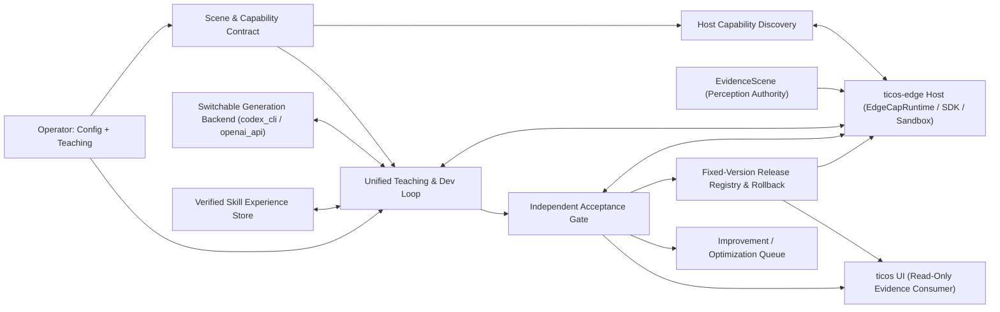

# CRAFT Architecture, Execution, and Ownership

CRAFT is the unified user-facing orchestration layer for configuring scenes,
teaching manipulation tasks, developing code policies, running independent
acceptance verification, managing fixed-version releases, and queuing
evidence-backed improvements.

See [`decisions/0003-product-architecture-and-reuse-boundary.md`](decisions/0003-product-architecture-and-reuse-boundary.md)
for the module-by-module reuse boundary and Phase 1 scope.

## System Architecture

## Ownership Boundaries

Strict separation of ownership is mandatory:

1. **Perception & World-State Authority (`ticos-edge` / EvidenceScene):**
   - `ticos-edge` owns RGB-D ingestion, SAM2/BundleTrack pose ownership,
     `OnlineTableWorldModel`, and scene snapshots returned by `/cap/state` and
     `EdgeZeroGtCoffeeSDK.observe_scene`.
   - CRAFT consumes scene observations read-only. It never adds a parallel
     detector, tracker, world model, or coordinate estimator. Video teaching
     materials are teaching evidence only and never override live scene state.
2. **Host Actuation & Sandbox Authority (`ticos-edge`):**
   - `EdgeCapRuntime._run_job`, `EdgeZeroGtCoffeeSDK` (`ConstrainedCoffeeRobotSDK`
     + `SDKPublicProxy`), and `execute_policy_in_subprocess_sandbox` own device
     interlocks, timeouts, command execution, and OS-level policy sandboxing.
   - CRAFT delegates live/simulator policy execution through the host adapter
     and never bypasses host interlocks or command identities.
3. **CRAFT Orchestration & Governance (`src/craft/`):**
   - **Configuration & Discovery (`config`, `edge_adapter`):** Declarative
     scene/object/capability/acceptance/budget contracts, automatic host
     capability discovery, staleness/ambiguity/disconnect checks, and
     query-first reconciliation for unknown non-idempotent outcomes.
   - **Generation Transport (`backends.py`, `generation.py`):** Adapted from
     `ticos-edge/tools/cap_llm_backends.py`. Explicit `codex_cli` or
     `openai_api` selection with `medium` default reasoning effort; generated
     code is always an unapproved draft.
   - **Teaching & Development Loop (`teaching`, `dev_loop`):** Structured task
     specs, ACE-inspired on-demand clarification/teaching requests, iterative
     candidate generation and execution, budget caps, pause/resume checkpoints,
     and complete failure retention.
   - **Independent Acceptance & Release (`acceptance`, `release`, `skills`):**
     Acceptance criteria frozen outside policy generation, held-out evaluation,
     reliability-first gating before latency comparison, fixed-version release
     registry with rollback, slow-step optimization queue, and verified skill
     experience records with applicability conditions.
   - **Core Contract Baseline (`policy.py`, `journal.py`, `runtime.py`,
     `contracts.py`, `fixtures.py`):** Preserved stdlib-only v0.1.0 components:
     `PolicyBundle` (content-hashed frozen policy), `Journal` (SQLite
     intent-before-dispatch), and `Execution` (restricted AST fixture runtime).
4. **Presentation Consumer (`ticos`):**
   - Read-only consumer of CRAFT/edge statuses, traces, and acceptance evidence.
   - Never runs inference, policy generation, or fallback object recognition.

## Receipt Lifecycle & Reconciliation

For non-idempotent physical or simulated actions (such as starting a brew cycle
or future appliance heating):

1. Bind a stable run ID to the frozen policy hash, parameters, deployment, and
   goal.
2. Derive each command ID from the run ID and a unique logical step key.
3. Commit intent durably before dispatch.
4. Record the adapter receipt. `running` or `unknown` suspends; `rejected`
   blocks.
5. On resume or reconciliation, reuse completed receipts and **query**
   unresolved commands (`query_command_status` / `Adapter.query`). Never infer
   absence of side effects from a timeout and never blindly redispatch a
   non-idempotent action.
6. Verify the host-bound goal independently before accepting a `completed`
   status.

A local SQLite journal is **not** a distributed exactly-once physical execution
protocol. Crashes between intent commit and dispatch, or loss of the journal,
require operator reconciliation.

## Evidence Separation

Every recorded trial, acceptance evaluation, and skill experience entry must
carry an explicit `evidence_source` tag:

- `fixture`: deterministic in-process software contract fixture (no robot/sim).
- `simulator`: live `ticos-edge` / Isaac simulation run.
- `recorded_data`: offline replay on recorded RGB-D / trace data.
- `physical_robot`: physical robot execution.

Fixture and simulator passes are never promoted as physical-robot approval or
food-quality certification.
